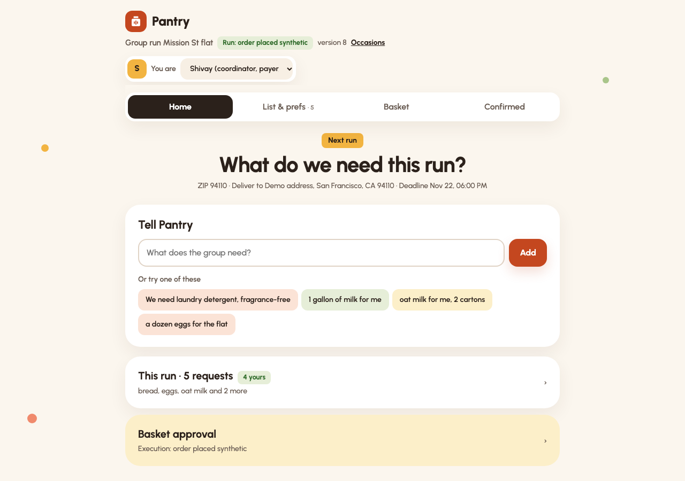
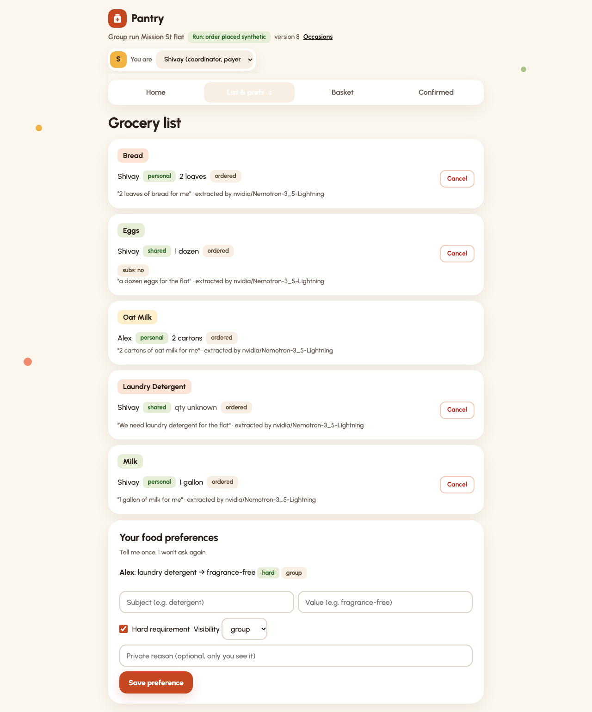
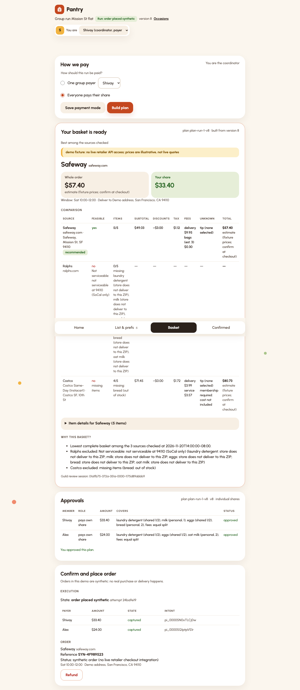
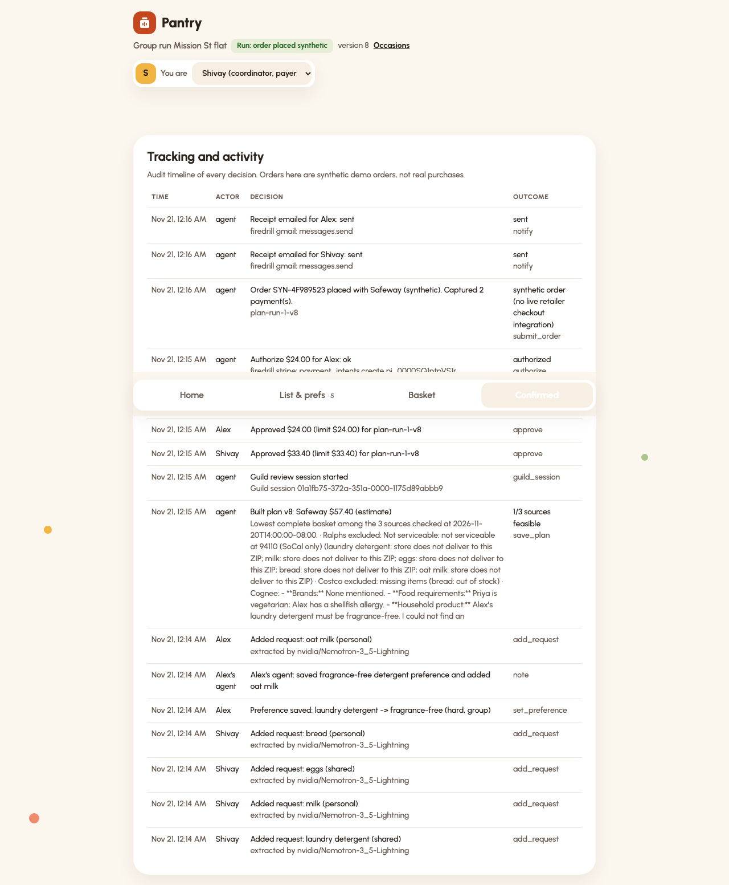
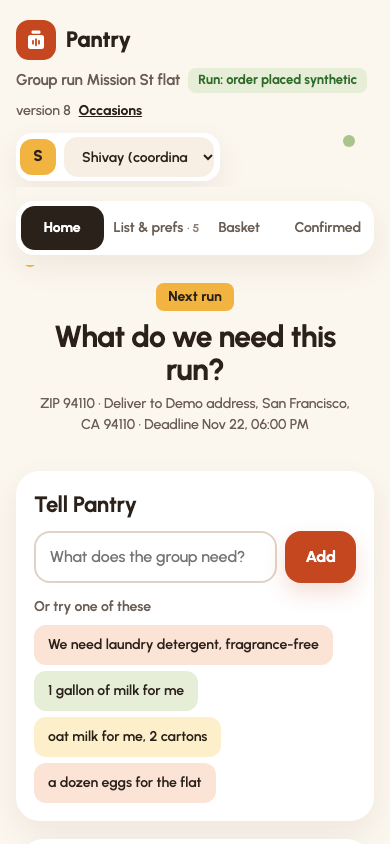

# Pantry: a group grocery agent with receipts

Pantry is a personal shopping agent for households, roommates and friends who shop together.
Everyone adds what they need, whenever they think of it, in plain words, from the web app or from
their own AI agent. Pantry remembers each person's preferences, compares complete baskets across the
stores it checked, splits the cost fairly, and pays only after every payer approves. Every step
leaves an audit trail.

Built at the Personal Agents Hackathon (San Francisco, 2026-11-20).

- **Web app:** `/group` (Pantry). The original family-occasions agent is at `/`.
- **Demo video:** `pantry-demo.mp4` (submitted separately)

## Screenshots

| Home | List and preferences |
|---|---|
|  |  |

| Basket: plan, approvals, payments | Audit trail |
|---|---|
|  |  |

Mobile: 

## How it works

1. **Ask in plain words.** "We need laundry detergent", "1 gallon of milk for me". Nemotron on Nebius
   Token Factory extracts the item, quantity and unit, shared vs personal, and required attributes,
   and keeps who asked. Unknown values stay unknown.
2. **Bring your own agent.** Each member's own agent (Claude, ChatGPT, Codex) connects to the family MCP
   server with a personal token. A preference set there ("detergent must be fragrance-free") changes
   the group's plan live, and the private reason behind it never leaves that person.
3. **Consolidate.** Shared supplies merge into one line with every requester kept; personal
   quantities stay allocated to each member.
4. **Compare complete baskets.** For every store checked, the agent picks compliant offers and computes
   pack counts, coupons, California tax, delivery and service fees in code. Unknown costs (tip,
   membership) are labelled as unknown. A basket missing an item is infeasible, never "cheaper".
   The result is "best among the sources checked", with time and location.
5. **Split fairly.** One group payer, or everyone pays their share. Personal items go to the requester;
   shared items and fees split equally. Shares reconcile to the order total to the cent.
6. **Approve, then pay.** Each payer approves the exact plan version, and any change voids the approval.
   The agent can never approve for anyone. Pantry authorizes every card, then captures:
   - a declined card releases the other holds and pauses the run;
   - a repeated request never double-charges;
   - refunds go back to the original payers.
7. **Receipts and audit.** Each payer gets an email receipt and the family Slack channel gets an
   update. The audit timeline records inputs, sources, decisions, approvals and outcomes, without
   private reasons.

## How we use every sponsor tool

| Partner | What it does in Pantry | Code |
|---|---|---|
| **Senso.ai** | Verified product facts are loaded into the Senso knowledge base (`senso_create_doc`). Required attributes ("fragrance-free") and seller claims are decided from `senso_search` evidence, and the document and score are cited in the trail. Tide Original is rejected because Senso's facts say it isn't fragrance-free. | `app/grocery.py` (`sync_grocery_kb`, `senso_attributes`), `app/senso.py` |
| **Cognee** | Per-member (`occasions_<member>_private`) and household (`occasions_household`) memory datasets via `/api/v1/remember`. Recall (`/api/v1/recall`) is scoped to the datasets that member may read; our server enforces access, never the model. Shared preferences go to Cognee, private reasons never do. | `app/memory.py`, `app/grocery.py` (`set_preference`) |
| **Firedrill** | Synthetic apps through their MCP servers. **Stripe:** `payment_intents.create` (manual capture), `capture`, `cancel`, `refunds.create`. **Gmail:** `messages.send` receipts. **Slack:** `chat.postMessage` to `#family`. **Google Calendar:** `events.list` / `events.insert` trigger the occasions agent. | `app/firedrill.py`, `app/grocery.py` (`execute`, `refund`) |
| **SingleStore** | The system of record: requests, preferences, run and plan versions, approvals, payment actions and audit events, with one table per record type. Falls back to a labelled SQLite fixture only if the cluster is unreachable. | `app/db.py` |
| **Superlinked (SIE)** | `BAAI/bge-m3` embeddings score how well each chosen product matches the original request (exact, likely or uncertain match), and rank candidates in the occasions agent. | `app/models.py` (`sie_scores`), `app/grocery.py` |
| **Amplitude + Statsig** | **Amplitude:** funnel events (`request_added`, `plan_built`, `plan_approved`, `order_placed`, `payment_failed`) with no names, shopping text or private preferences. **Statsig:** the `agent_settings` dynamic config sets the auto-buy limit (`auto_buy_under`) and how early the agent acts (`act_days_before`), read on every run. | `app/telemetry.py`, `app/agent.py` |
| **Persona** | A GovID sandbox inquiry verifies the human behind a spending mandate. The occasions agent never buys for an unverified member. | `app/persona.py` |
| **Tokens&** | The official `tokensand_observe` SDK sends metadata-only telemetry (model, timing, token counts, status) for every Nemotron call and every MCP tool call. No prompts or outputs are sent. | `app/tokens.py`, `app/models.py`, `app/mcpcall.py` |
| **Guild AI** | Every basket plan starts a review session with our `shopping-agent` in a Guild workspace (`POST /v1/workspaces/{id}/sessions`). The prompt holds only non-personal metadata, and the session ID is recorded in the plan and audit trail. | `app/guild.py`, `app/grocery.py` (`plan`) |
| Nebius Token Factory | Nemotron (`nvidia/Nemotron-3_5-Lightning`) for request extraction and decisions. | `app/models.py`, `app/grocery.py` (`extract`) |

Not used: Airbyte (no source worth syncing for this flow) and Arcee AI (no API credit was available).

## Family MCP server

`app/mcp_server.py`, served over streamable HTTP on `:8701/mcp`. The member's identity comes from their
token (`Authorization: Bearer <token>`, or `?token=` for connector UIs that only take a URL); the
model never supplies it.

| Tool | Purpose |
|---|---|
| `get_group_context` | Members, delivery ZIP, payment mode, preferences you may see |
| `add_request` / `update_request` | Add a need in plain words; change or cancel your own |
| `set_preference` | Remember a preference (shared value; the reason is never shared) |
| `get_run_snapshot` | Requests, plan, approvals, order state |
| `save_plan` | Compare baskets and save a new plan version (it cannot approve or pay) |
| `append_audit_event` | Add a note to the audit trail |

Family-occasions tools are also exposed: `upcoming_occasions`, `recall`, `remember`, `plan_and_buy`, `receipt`.

## Run

```
python3 -m venv .venv && .venv/bin/pip install -r requirements.txt
./run.sh                      # web :8700, MCP :8701 (reads .env, chmod 600)
.venv/bin/python -m pytest -q tests     # 23 tests: allocation reconciliation, approvals, idempotency,
                                        # declined card, privacy, group isolation, agent safety rules
bash scripts/e2e_group.sh     # live end-to-end group run against the running server
```

### `.env` (names only)
`NEBIUS_API_KEY SENSO_API_KEY SENSO_ORG_ID SENSO_MCP_URL COGNEE_API_KEY COGNEE_BASE_URL
FIREDRILL_{GMAIL,GOOGLE_CALENDAR,SLACK,STRIPE}_MCP_URL SINGLESTORE_URL SIE_API_KEY SIE_ENDPOINT
STATSIG_SERVER_SECRET AMPLITUDE_API_KEY PERSONA_API_KEY PERSONA_TEMPLATE_ID PERSONA_LIVE
TOKENS_OBSERVE_API_KEY TOKENS_OBSERVE_INGEST_URL GUILD_API_KEY MEMBER_TOKENS PUBLIC_BASE_URL`

## Honest limits

- No live retailer API access (Safeway, Costco, Instacart) was available during the event. Store
  prices are a labelled demo fixture, and orders are marked "synthetic", never "purchased" or
  "delivered". Delivery tracking is not implemented.
- The web app uses a member switcher for the demo. MCP access uses per-member tokens.
- Payments run in Firedrill's synthetic Stripe; no real money moves.

## Also in this repo: family occasions (`/`)

The first agent we built. It watches the family calendar. Days before a birthday or dinner, it
recalls what the family knows (Cognee), checks every seller claim against Senso, and rejects:
- false shipping claims;
- counterfeit sellers;
- allergens;
- items the person already owns;
- a prompt-injection review.

It then picks with Nemotron and SIE, buys within a Persona-verified, Statsig-controlled mandate
through a signed Personal Agent Protocol store, and shows a receipt of what it knew, checked and did.
