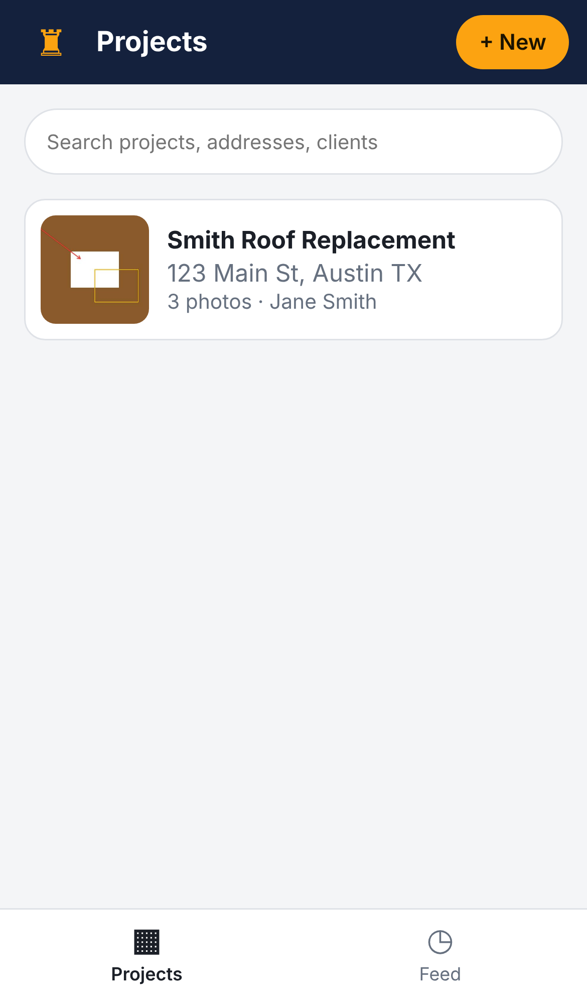

# Empire

Phone-first job site photo documentation, as an installable web app (PWA).



## Features

- **Projects**: one per job site, with address, client and GPS location, a Directions link, and search.
- **Camera capture**: the big orange button opens the phone camera. You can also bulk-upload from the photo library. Photos are resized (max 2048 px) and stamped with the time and your location.
- **Timeline**: each project's photos are grouped by day. The **Feed** tab shows recent photos across all projects.
- **Photo details**: a time/GPS/address stamp, notes, tags, swipe-style newer/older arrows, share (the native share sheet on phones, otherwise a download) and delete.
- **Markup**: draw, arrow, box and text tools, five colors and undo. The original photo is kept, so you can always restore it.
- **Reports**: pick photos, add a title, "prepared by" and a summary, then use **Save as PDF / Print** to get a clean client-ready report.
- **Offline & installable**: a service worker plus web manifest. On a phone, use "Add to Home Screen".

Data lives on the device (IndexedDB), so there's no account or server yet. Clearing site data deletes it.

## Develop

```bash
npm install
npm run dev          # http://localhost:5173 (use --host to open from your phone on the same Wi-Fi)
npm run build        # static site in dist/ – deploy to Netlify, Vercel, GitHub Pages, etc.
npm test             # unit tests (database + helpers)
npm run test:e2e     # Playwright, iPhone 13 viewport, full workflow
```

The camera and location require HTTPS (or `localhost`), so deploy to an HTTPS host to use it on a phone.

## Roadmap

1. Accounts + cloud sync (Supabase: auth, Postgres, photo storage) so teams share projects.
2. Team members, comments and @mentions on photos.
3. Checklists / punch lists per project.
4. Map view of all projects; before/after comparisons; shareable public galleries.
